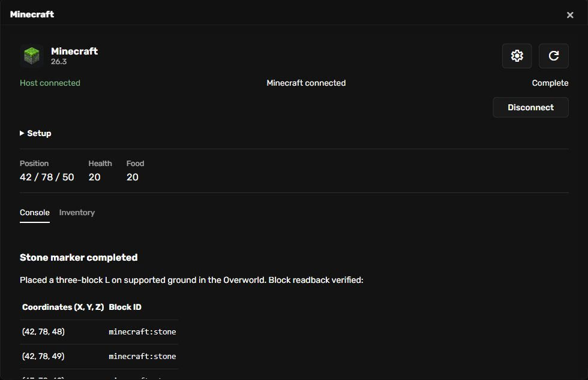

# Minecraft

Agent Zero native Minecraft control: one right-canvas rail entry, with Launcher managing the Windows connection. Agent Zero can run locally or on a VPS. No shared folder, port forwarding, or public Minecraft bridge is needed.



## Install the plugin

Requires an Agent Zero build with the Plugin Hub, model presets, and Launcher Host gateway, plus Agent Zero Launcher on the Windows computer running Minecraft. The browser alone cannot provide the Windows host connection. Minecraft Java Edition ownership and a supported MCPFabric release are required.

In Agent Zero's Plugin Hub, install from this repository URL:

`https://github.com/3clyp50/a0-minecraft-control`

Enable **Minecraft**, select a chat, and open its icon in the right canvas rail. The panel includes Setup and connection instructions. There is no sidebar button. The Plugin Index submission is pending; repository installation works independently of index inclusion.

## First connection

1. Open the Agent Zero instance in Launcher on the Windows computer that runs Minecraft. For a VPS, use its HTTPS URL and sign in normally.
2. Enable Launcher Host access: Files, Read & write, and Code execution. Keep that instance tab open.
3. Select an Agent Zero chat and open **Minecraft** from the right canvas rail. Setup detects your host and loads matching stable Minecraft versions.
4. If missing, install [Minecraft Launcher](https://www.minecraft.net/download), open Java Edition once, then close the launcher. Install [Node.js 22.16+ with npm](https://nodejs.org/en/download) if Setup requests it, then restart Agent Zero Launcher.
5. Select your Minecraft version and click **Install profile**. For Realms, choose the Realm's version. This installs Fabric Loader, Fabric API, and MCPFabric into a new **Agent Zero <version>** profile. It also installs a missing MCP server when Node/npm is available.
6. Click **Open Minecraft Launcher**, select that Agent Zero profile, and click **Play**. Microsoft sign-in, game ownership checks, any launcher warning, game downloads, and Java runtime provisioning stay in the official launcher.
7. Join a world, then click **Connect** in Agent Zero and enter your request.

Existing CurseForge profiles with Fabric and MCPFabric still work with Connect. Automatic profile creation uses the official Minecraft Launcher, to preserve existing installations. No Minecraft access token or model API key needs copying into the plugin.

**Use the Agent Zero Minecraft profile for AI control.** The ordinary, unmodified default Minecraft profile cannot connect to MCPFabric. It stays untouched. Minecraft Launcher's modified-installation notice is expected for the Fabric profile created here.

Sign in to Minecraft Launcher with the Microsoft account that has your Minecraft license and Realm access. Existing single-player worlds are not copied into the new profile; the new profile has its own world folder.

Official sources: [Fabric on Windows](https://docs.fabricmc.net/players/installing-fabric/windows), [Fabric launch metadata](https://meta.fabricmc.net/), [Modrinth release metadata](https://docs.modrinth.com/api/operations/getprojectversions/), and [manual MCPFabric setup](https://github.com/denfry/mcpfabric#quick-start).

## Profile installation and preservation

The installer offers only stable Minecraft releases with matching stable Fabric API and MCPFabric files. It selects a compatible stable Fabric Loader (0.19.5+), uses the Java runtime specified by Mojang's release metadata, verifies both mods with Modrinth's SHA-512 hashes, and verifies Fabric libraries with published SHA-256 hashes. Downloads use fixed official HTTPS hosts; additional unrecognized required mods stop installation with guidance.

The profile's game directory is `%LOCALAPPDATA%/AgentZero/MinecraftProfiles/<instance-id>/<version>/game`. Its mods, worlds, settings, and installation record remain outside the disposable companion cache. Minecraft Launcher gets a separate custom profile and Fabric version. Necessary official libraries and base-version metadata are added only when absent; existing files are never silently replaced.

Close Minecraft Launcher before installation. The installer checks both Store and desktop launcher processes, copies each existing launcher profile configuration to a uniquely named `.agent-zero-<id>.bak` beside it, and preserves all existing profiles and settings. If settings change during installation, it stops instead of overwriting them. A failed registration can be retried; repeated installation does not duplicate the profile or replace worlds/modifications. Modified mods are preserved and require manual repair.

Uninstalling this plugin **preserves generated Minecraft profiles and worlds**, along with shared launcher libraries and backups. Remove a profile through Minecraft Launcher only when you no longer want it. The installer does not change your CurseForge installation, copy existing worlds, or transfer Microsoft credentials.

For Realms, match the Realm's current version. Client placement and movement work through MCPFabric; server-only tools require an integrated or dedicated modded server. Realms cannot host this server mod. Operator access permits slash commands through chat when you explicitly request them; it does not enable server-side MCP tools. New Minecraft releases appear in Setup only after compatible stable Fabric API and MCPFabric releases exist.

## What gets installed

Lifecycle hooks create the server-side instance identity and, when Launcher host access is available, prepare the Windows helper and install a missing MCP server if Node/npm is ready. If the host is unavailable at plugin installation, the same host setup is completed from the panel when it connects. The Install MCP server button uses that lifecycle helper.

Windows files live under `%LOCALAPPDATA%/AgentZero/Minecraft/<instance-id>/`. The pinned npm package is `mcpfabric-mcp-server@0.10.0`; installation stays in that plugin-owned directory, uses the official npm registry, and disables package lifecycle scripts. Existing Node.js, Java, Minecraft profiles, worlds, and other applications' dependencies are preserved. An existing MCPFabric server entry in `.codex/config.toml` can be reused, but Codex CLI/configuration is not required when using the plugin-owned installation.

Launcher supplies the Windows Python execution environment. The plugin deploys its small host helper over Launcher's existing authenticated connection; it never uploads model credentials. MCPFabric's discovery file and bearer token stay on Windows. `host.log` and `install.log` in the Windows cache contain setup diagnostics.

## Controls and models

Connect starts the companion. Disconnect cancels the task, releases game controls, and stops the companion; Minecraft stays open. Stop cancels only the current task. Closing the canvas does not stop a task. Closing the owning Launcher instance tab, revoking host access, disabling the plugin, or losing the connection ends the companion lease. After reboot, open Agent Zero Launcher and your instance, launch the Agent Zero profile in Minecraft Launcher, join a world, then click Connect. Enter build requests in the Minecraft panel's Request field and click Run.

The **Models** setting selects an Agent Zero model preset; it does not select a Minecraft installation. Plugin settings default to **Inherit current chat**. Choose an existing preset to override it for Minecraft. All model slots and authentication resolve through Agent Zero: existing Codex OAuth or provider API keys are reused. The plugin does not select a premium service tier or require a separate model login. Usage follows your configured provider pricing or subscription limits. Avoid running another Minecraft controller at the same time.

## Transport and cleanup

Tool requests, status, and results cross the existing Launcher gateway. The Windows companion uses a private local queue; the server never reads or writes that queue. Large results, including screenshots, use bounded chunks with size and SHA-256 verification, capped at 32 MiB. Results are saved to Agent Zero's normal chat-media storage for vision. Failed or uncertain game actions are never replayed automatically.

The bridge remains bound to 127.0.0.1 on Windows. There is no new public listener. The plugin exposes the same 36 enabled MCPFabric tools and preserves its argument validation, mod pause controls, reach, game permissions, and Agent Zero tool policy. Game text remains untrusted data.

Heartbeat renewal is bound to the exact authorized Launcher session. The companion stops when its host-local lease expires (30 seconds without renewal); an already dispatched call may finish before controls are released. Disconnect cannot undo completed changes. Server and Windows clocks need not agree.

Uninstall attempts to stop the connected companion and remove its instance-specific Windows cache, including only its own npm installation. Server-side identity/state is removed. If Windows is offline or the server has restarted and no host connection has been established, remote files cannot be removed at that moment: the companion still expires, and the instance-specific cache can be removed from the Windows folder above. Shared dependencies, profiles, worlds, presets, and credentials remain untouched.

## Thumbnail

`webui/thumbnail.webp` is 256 x 256 pixels, 4,356 bytes. Generated with the built-in imagegen tool and resized/compressed locally.

Prompt: Use case: stylized-concept. Asset type: square thumbnail for an Agent Zero Minecraft control plugin, to be reduced to 256x256. A single beautifully constructed isometric grass-topped stone voxel cube, small inset abstract circuit traces on the stone faces, on a matte charcoal background. Restrained green and silver, crisp geometric edges, premium minimal 3D illustration, centered generous margins, legible at tiny size. No text, no letters, no watermark, no UI.

## Development and verification

The Windows host tests use Python's standard library:

```powershell
python -m unittest discover -s tests -p test_controller.py
python -m unittest discover -s tests -p test_dependencies.py
python -m unittest discover -s tests -p test_host.py
python -m unittest discover -s tests -p test_profiles.py
node tests/test_store.mjs
node tests/test_setup_store.mjs
```

Run the remaining Python tests from Agent Zero's framework environment, with this plugin installed as `usr/plugins/minecraft_control`. They exercise native model resolution, task scope, lifecycle hooks, authorization, and gateway transport. CI runs the standalone host/UI tests; it does not launch Minecraft or require provider credentials.

Verified on Windows with Minecraft 26.3, Fabric Loader 0.20.1, Fabric API 0.166.2+26.3, MCPFabric 0.10.0+26.3, and Java 25 metadata. The regression suite covers preserved profiles/worlds, backups, repeat installation, interrupted registration, checksums, path bounds, launcher races, authorization, task isolation, lease expiry, and chunked screenshot transfer. Native Codex OAuth and an OpenRouter preset have both been exercised. A final request started from the Minecraft panel using the Default preset built a three-block stone marker in the generated profile; independent block readback confirmed all three placements. Screenshot transfer and vision loading succeeded, but the pause menu obscured the game image, so build verification relied on block data.

Agent Zero and Minecraft were tested on separate container/Windows filesystems with no shared-folder transport. An actual public VPS deployment, internet latency, and TLS/reverse-proxy configuration have not been tested.

## License and acknowledgments

MIT. Fabric, Fabric API, MCPFabric, Minecraft, and Agent Zero remain subject to their respective licenses and terms. This is an independent community plugin, not an official Minecraft or Mojang product.
